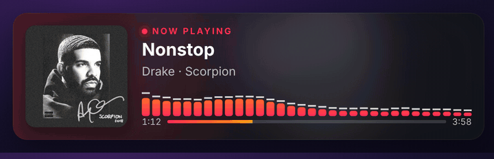
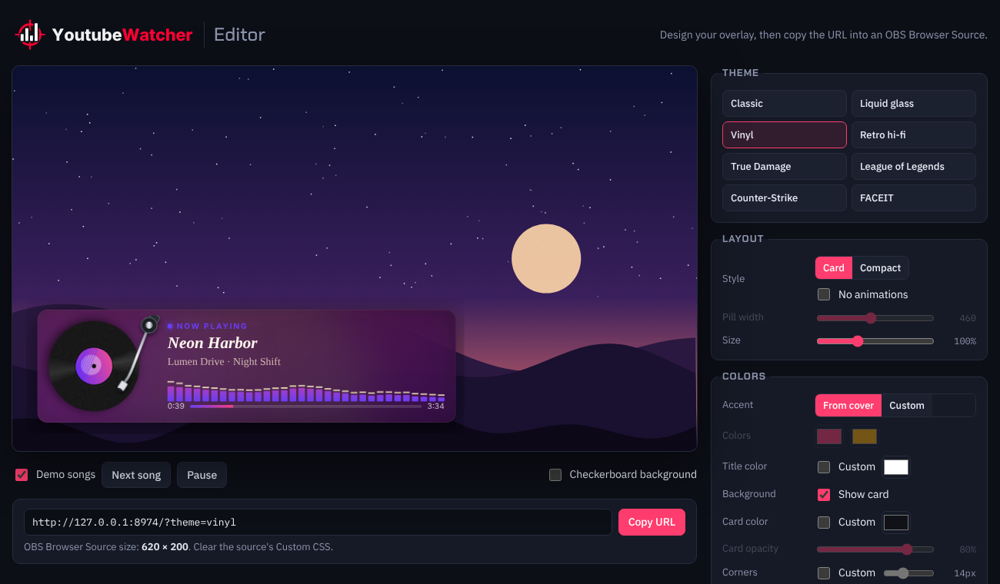
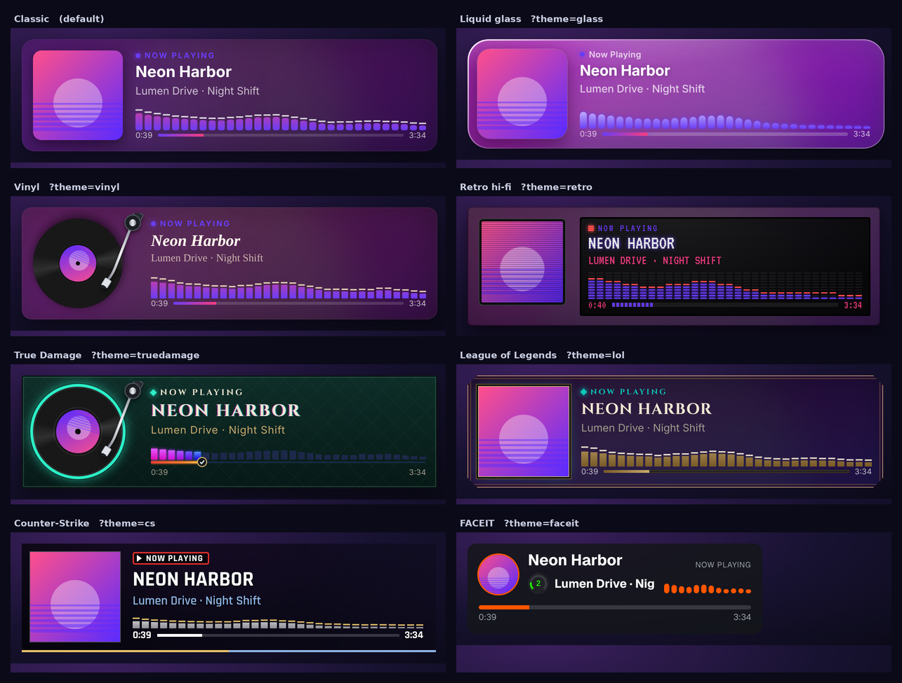
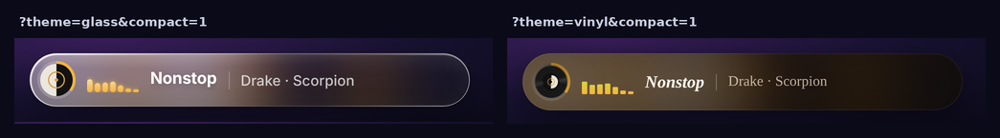

<h1>
  <picture>
    <source media="(prefers-color-scheme: dark)" srcset="docs/logo/logo-animated.svg">
    
  </picture>
</h1>

Show the song you're playing on **YouTube Music** in your OBS stream: cover, title, artist, progress and an equalizer that moves with the music.



- 8 designs, from a clean card to a spinning record, plus game styles for League of Legends, Counter-Strike and FACEIT
- An editor in your browser to change colors, fonts, size and more, with a live preview
- Runs on your own computer. No account, no API key, nothing is sent anywhere

## Setup

You need **[Node.js](https://nodejs.org)** (version 18 or newer) and a browser extension for userscripts: **[Tampermonkey](https://www.tampermonkey.net)** or **[Violentmonkey](https://violentmonkey.github.io)**.

### 1. Download

Click **Code → Download ZIP** on this page and unzip it, or run:

```bash
git clone https://github.com/Fersehet/YoutubeWatcher.git
```

### 2. Start the server

- **Windows:** double-click `start-windows.bat`
- **macOS / Linux:** run `./start.sh` in a terminal

A window opens and says the overlay is running. Keep it open while you stream.

### 3. Install the userscript

With Tampermonkey or Violentmonkey installed, open this link and click **Install**:

**[Install yt-music-now-playing.user.js](https://raw.githubusercontent.com/Fersehet/YoutubeWatcher/main/yt-music-now-playing.user.js)**

> Chrome only: open the Tampermonkey extension details (`chrome://extensions`) and turn on **Allow User Scripts**, otherwise the script won't run.

### 4. Add it to OBS

1. In OBS, click **+** under Sources and choose **Browser**.
2. URL: `http://127.0.0.1:8974/`
3. Width `620`, height `200`.
4. Delete the text in **Custom CSS**.

### 5. Play music

Open [music.youtube.com](https://music.youtube.com) (reload it if it was already open), start a song and **click once anywhere on the page**. The overlay appears in OBS.

The click is needed because browsers only allow reading the audio after you interact with the page. Until then the equalizer plays a made-up animation.

## Customize it

With the server running, open **[http://127.0.0.1:8974/editor](http://127.0.0.1:8974/editor)**.



1. Pick a theme and change whatever you like. The preview updates right away. Untick **Demo songs** to see your own music.
2. Click **Copy URL**.
3. In OBS, open your Browser source, paste the URL and set the width and height the editor shows under the URL.

The editor remembers your settings.

## Themes



Every theme also has a **compact** version, a slim one-line bar where the progress runs around the cover:



Most themes take their colors from the album cover. The game themes use their own colors.

## All options

The editor writes these for you. If you prefer, add them to the OBS URL yourself, starting with `?` and joined with `&`, for example `http://127.0.0.1:8974/?theme=vinyl&compact=1`.

**Look**

| Option | Example | What it does |
|---|---|---|
| `theme` | `?theme=vinyl` | `classic` (default), `glass`, `vinyl`, `retro`, `truedamage`, `lol`, `cs` or `faceit` |
| `compact` | `?compact=1` | Slim one-line version |
| `width` | `?compact=1&width=380` | Width of the compact bar in pixels (default 460). Long names scroll inside |
| `scale` | `?scale=1.5` | Make everything bigger or smaller (0.3 to 3). Multiply the OBS width and height by the same number |
| `card` | `?card=0` | No background, just the content |
| `still` | `?still=1` | No animations: no equalizer, no scrolling text, no spinning record |

**Colors and text**

| Option | Example | What it does |
|---|---|---|
| `accent` | `?accent=00e5ff` | Your own main color instead of one from the cover |
| `accent2` | `?accent2=ffb000` | Second color for gradients, used with `accent` |
| `text` | `?text=ffffff` | Title color |
| `bg`, `bgAlpha` | `?bg=101218&bgAlpha=0.6` | Background color and how see-through it is (0 to 1) |
| `radius` | `?radius=4` | Corner rounding in pixels |
| `font` | `?font=Poppins` | Any font from [Google Fonts](https://fonts.google.com) |
| `label` | `?label=On+air` | Text instead of "Now Playing" |
| `showLabel` | `?showLabel=0` | Hide that text |

**What to show**

| Option | Example | What it does |
|---|---|---|
| `album`, `cover`, `eq`, `progress` | `?album=0` | Set to `0` to hide the album name, cover, equalizer or progress bar |
| `bars` | `?bars=24` | Number of equalizer bars (default 32) |
| `hidePaused` | `?hidePaused=1` | Hide the overlay while the music is paused |
| `demo` | `?demo=1` | Show demo songs instead of your music, for testing |

## Troubleshooting

- **Nothing shows up in OBS:** check that the server window is still open, and that the userscript is on for music.youtube.com (the Tampermonkey icon shows a "1" on that tab). Reload YouTube Music.
- **The equalizer moves but not with the music:** click once on the YouTube Music page.
- **YouTube Music goes quiet:** click once on the page. If it stays quiet, turn the userscript off, reload, and open an issue.
- **Port 8974 is already in use:** start the server with another port, for example `PORT=9000` (on Windows: `set PORT=9000` before `node server.js`), and change `SERVER` at the top of the userscript to the same port.

## How it works

```
YouTube Music tab (userscript)  ──▶  server.js on your computer  ──▶  OBS Browser Source (overlay.html)
```

The userscript reads the song info from the YouTube Music page and measures the audio with the browser's Web Audio API. It sends both to `server.js`, a small Node server with no dependencies, which passes them on to the overlay in OBS. Everything stays on `127.0.0.1`.
